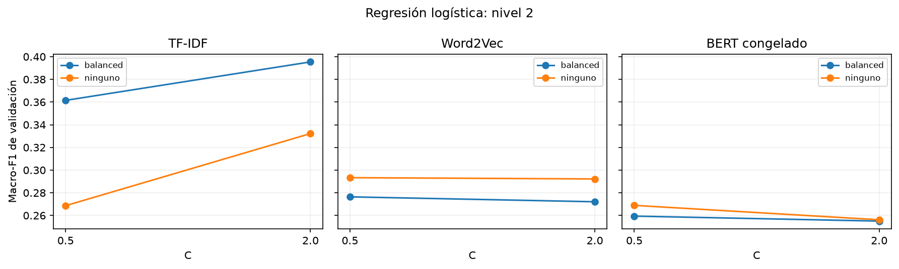
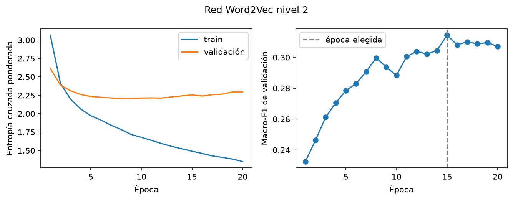
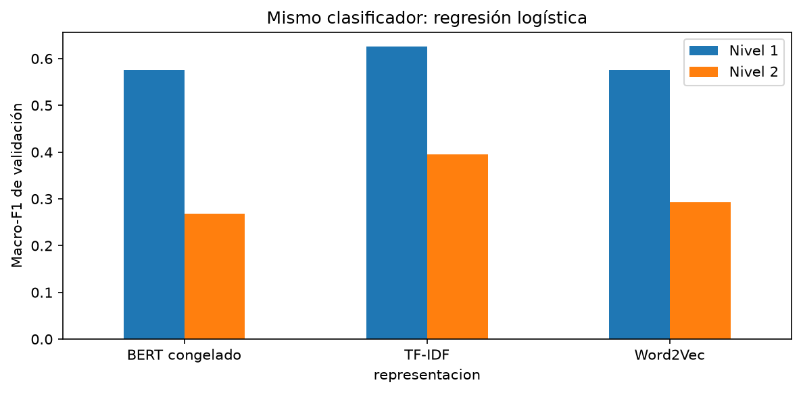
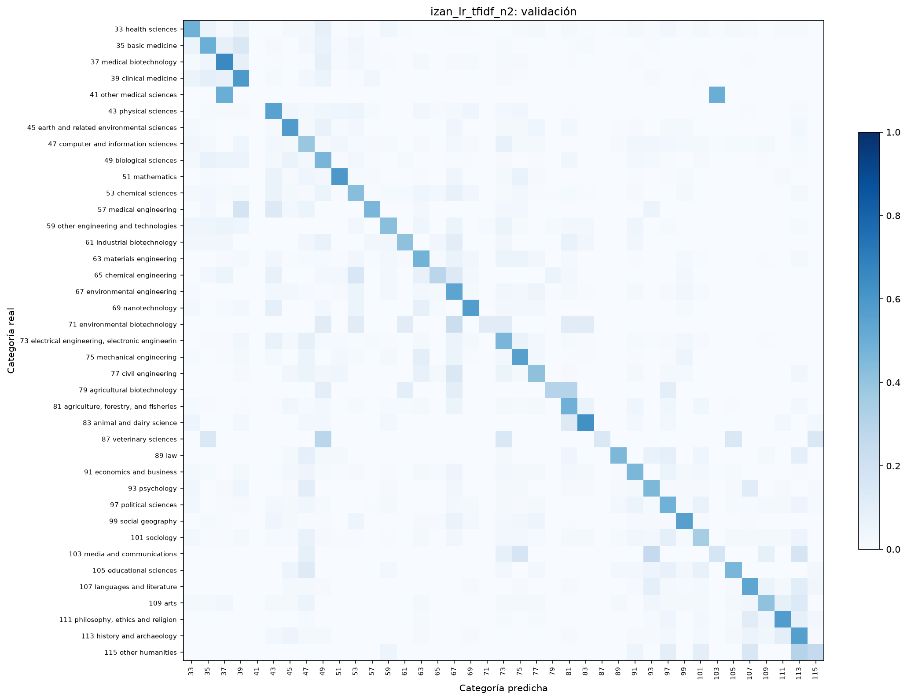
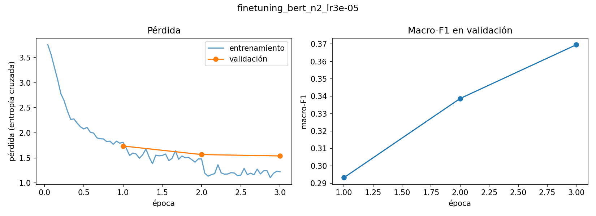
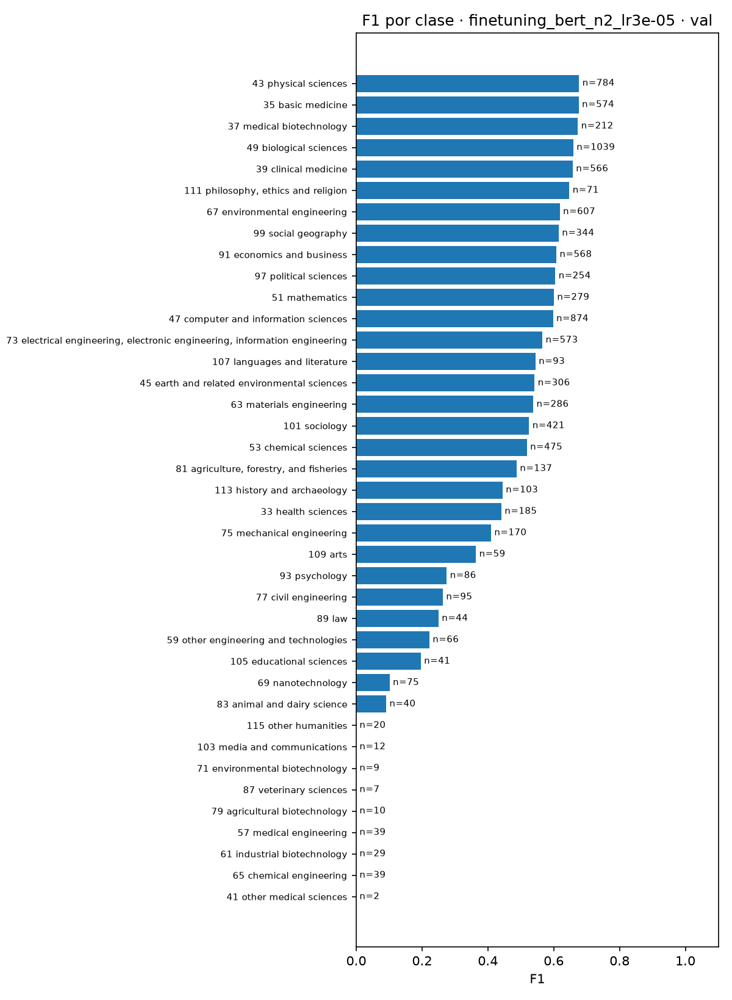
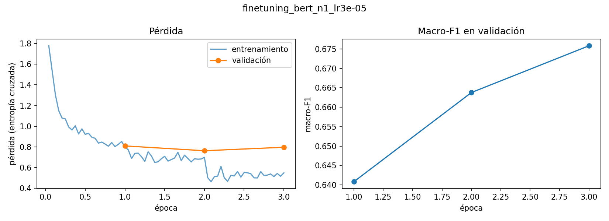
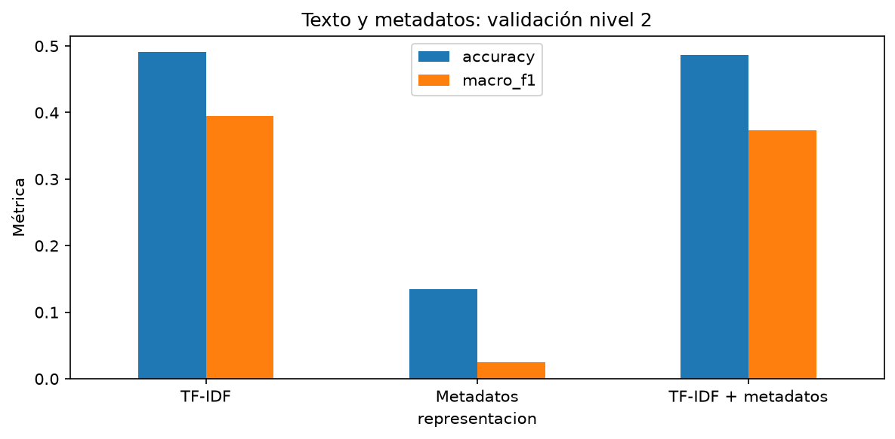

# Proyecto CORDIS

Trabajo de Tratamiento de Datos sobre clasificación de proyectos de investigación.
Queremos predecir el área científica de un proyecto a partir de su resumen y
comparar distintas representaciones y modelos.

**Estado:** resultados reales de validación de todos los modelos, con la
comparación conjunta y su incertidumbre. Las decisiones se han elegido con
validación. La evaluación final en test sigue pendiente.

## Cómo nos repartimos

Mónica hizo el cuaderno original, incluidos el inicio de la regresión logística
y el extractor BERT. Esa aportación sigue siendo suya aunque el código esté
repartido entre los tres cuadernos. Su carga nueva será menor para reconocer
ese trabajo previo.

| Persona | Archivos principales | Responsabilidad |
| --- | --- | --- |
| Mónica | `01_datos_y_representaciones.ipynb` | Revisar datos y etiquetas, generar TF-IDF y Word2Vec y explicar la exploración |
| Izan | `02_modelos_y_extension.ipynb` y `funciones.py` | Mantener las funciones, ajustar clasificadores, hacer la red y la extensión |
| Sara | `03_bert_y_comparacion.ipynb` | Completar BERT, hacer fine-tuning y comparar los resultados |

**Solo Izan edita `funciones.py`.** Mónica y Sara le comunican los ajustes que
necesiten. Los tres escriben sus apartados del README y preparan sus diapositivas.
Sara reúne el informe e Izan reúne las diapositivas. Las conclusiones se revisan
entre los tres. La declaración final de contribuciones reflejará lo que se haga
realmente, sin tratar la plantilla o los apartados pendientes como trabajo terminado.

El reparto detallado, las dependencias y el Gantt están en
`Reparto_y_calendario_CORDIS.pdf`.

## Qué hay en cada archivo

- `01_datos_y_representaciones.ipynb`: preparación, exploración, TF-IDF y Word2Vec.
- `02_modelos_y_extension.ipynb`: clasificadores ajustados, red propia y extensión ejecutados en validación; evaluación final en test desactivada.
- `03_bert_y_comparacion.ipynb`: BERT congelado, fine-tuning de BERT, tabla común de resultados, incertidumbre y análisis de errores.
- `funciones.py`: funciones que comparten los cuadernos; responsable único: Izan.
- `datos/`: Excel y vectores locales; quedan fuera de GitHub.
- `resultados/`: reparto de proyectos, métricas, predicciones y gráficas.
- `presentacion.md`: guion inicial para preparar las diapositivas.

El cuaderno original se conserva en su ubicación inicial fuera de esta carpeta.
El código existente de preparación, representaciones, BERT y primera regresión
logística se repartió entre estos archivos. Se limpiaron sus salidas al crear la
base; las salidas actuales de los cuadernos 02 y 03 corresponden a las ejecuciones
registradas en resultados/.

## Problema y datos

El conjunto original contiene 35.378 proyectos H2020. Utilizamos `summary` como
entrada del proyecto básico y construimos la etiqueta con `euroSciVocCode` y el
catálogo `SciVocCodes.xlsx`.

Para cada proyecto recorremos sus códigos en el orden disponible y elegimos el
primero cuyo camino tenga una categoría de nivel 2. Guardamos esa categoría y su
raíz de nivel 1. Descartamos proyectos sin una categoría válida.

La preparación actual conserva 31.982 proyectos (90,40 %), con 39 categorías de
nivel 2 y 6 de nivel 1. El reparto guardado contiene 19.189 proyectos de
entrenamiento, 9.594 de validación y 3.199 de test.

**Pendiente:** explicar la diferencia entre el porcentaje conservado que se
obtiene con la preparación actual y el 90,31 % aproximado indicado en el
enunciado. No se ha modificado la regla para forzar ese porcentaje.

El análisis exploratorio incluye valores ausentes, clases y desbalance, un
clasificador que siempre predice la clase mayoritaria, longitud de resúmenes,
proyectos por año y país, palabras frecuentes y ejemplos de proyectos.

**Pendiente:** incluir aquí las figuras y explicar las observaciones principales.
Las gráficas deben poder verse en este README sin ejecutar los cuadernos.

## Método

### Entrenamiento, validación y test

Se mantiene el reparto del cuaderno original: 60 % entrenamiento, 30 % validación
y 10 % test, con semilla 42 y estratificación por la etiqueta de nivel 2.
`resultados/particiones.csv` guarda los identificadores, etiquetas y orden.
Los tres cuadernos reutilizan ese archivo y avisan si los datos ya no coinciden.

El vocabulario, los embeddings entrenados con el corpus, la imputación y el
escalado se ajustan únicamente con entrenamiento. Los hiperparámetros se eligen
con validación; el test se reserva para el final.

### Representaciones

- **TF-IDF:** lematización con spaCy, minúsculas y eliminación de stopwords,
  números y tokens de hasta dos caracteres. Como configuración inicial:
  `max_features=10000`, `min_df=5`, `max_df=0.90` y unigramas/bigramas.
- **Word2Vec:** entrenado únicamente con los textos de entrenamiento. La base
  usa 300 dimensiones, ventana 5, `min_count=2`, skip-gram y 10 épocas.
  Usamos un trabajador y semilla 42 para facilitar la repetición. Promediamos
  las palabras conocidas; si no hay ninguna, devolvemos ceros. El cuaderno
  calcula cuántas palabras quedan fuera de vocabulario y cuántos documentos
  carecen de un vector utilizable.
- **BERT congelado (Sara):** `bert-base-uncased` usado solo como extractor de
  características: modo evaluación, sin gradientes y con los pesos sin cambiar. La
  entrada es el `summary` original, sin el preprocesamiento de spaCy, porque BERT
  tiene su propio tokenizador y aprovecha el contexto completo. Cada resumen se
  representa con la **media de los vectores de la última capa** de todos sus tokens
  reales: la máscara de atención excluye el padding, y la media incluye `[CLS]` y `[SEP]`.
  Así se obtienen 768 dimensiones. Se prefiere la media al vector de `[CLS]` porque, sin
  fine-tuning, `[CLS]` no está entrenado para resumir el documento.
  Los textos de más de 512 tokens se truncan. Lo hemos **medido**: la mediana es de
  366 tokens, el percentil 95 de 423, y solo 28 de 31.982 resúmenes (0,09 %) superan
  el límite, así que no compensa dividirlos en ventanas. La extracción completa
  tardó 16,5 minutos en una GPU T4 (configuración en
  `resultados/bert_congelado_config.json`). Los vectores se guardan en
  `datos/cache/bert.joblib`, fuera de GitHub, con una huella que comprueba los proyectos y su orden.

### Modelos

Ya está trasladada la primera regresión logística con TF-IDF.

**Modelos de Izan.** Se ajusta regresión logística con TF-IDF, Word2Vec y BERT
congelado, manteniendo los mismos proyectos y la misma búsqueda: `C` en
`[0.5, 2.0]`, con y sin `class_weight="balanced"`. Se usa `lbfgs`, hasta 600
iteraciones y tolerancia 0,001. Se elige por macro-F1 de validación; no se ha usado
test. Word2Vec y BERT se estandarizan con train; TF-IDF permanece disperso y con
su normalización del vectorizador. Se repite la búsqueda en niveles 1 y 2.

La red propia de PyTorch usa Word2Vec, una capa oculta ReLU y dropout. Se prueban
128 neuronas, dropout 0,2 y tasa 0,001, y 256 neuronas, dropout 0,3 y tasa 0,0005.
Se entrena con Adam, lotes de 256 y entropía cruzada ponderada por la frecuencia
inversa de las clases de train, hasta 30 épocas. Se detiene tras cinco épocas sin
mejora en macro-F1 de validación y se recupera la mejor época. El escalado y el
mapeo de categorías se aprenden solo con train. Se repite en nivel 1.

Las representaciones TF-IDF y Word2Vec se regeneraron localmente con las
funciones y parámetros iniciales de Mónica; BERT se cargó desde la caché de Sara.
Las versiones efectivas están en `resultados/entorno_izan.json`, las búsquedas en
`busqueda_lr_izan.csv` y `busqueda_red_izan.csv`, y las configuraciones elegidas en
`resultados/configuraciones_izan.json`.

**Fine-tuning de BERT (Sara).** A diferencia de BERT congelado, aquí se
actualizan todos los pesos del Transformer con las etiquetas del problema. Se usa
`AutoModelForSequenceClassification` de Hugging Face: el mismo `bert-base-uncased`
más una capa lineal sobre `[CLS]`. Usar el mismo modelo base que en la versión
congelada permite atribuir la diferencia a la adaptación de los pesos.

- Entrada: el `summary` original, `max_length=512` (truncamiento despreciable,
  ver arriba) y padding por lote. Mismas particiones que el resto del grupo.
- Etiquetas: los códigos EuroSciVoc se convierten en índices 0…K−1 con las clases de
  train. El mapeo se guarda en `resultados/finetuning_mapeo_nivel{N}.json`.
- Entrenamiento: AdamW, lote 16, 3 épocas, decaimiento de pesos 0,01, calentamiento
  lineal del 10 % de los pasos, fp16 y semilla 42, en una GPU T4 de Colab. Estos
  valores están dentro de los rangos que recomiendan Devlin et al. (2019) para BERT.
- Selección: evaluación en validación al final de cada época, conservando la de
  mejor macro-F1. Entre tasas de aprendizaje también se elige por macro-F1 en
  validación. El test no interviene.

| Tasa de aprendizaje | Épocas | Mejor época | Accuracy val | Macro-F1 val | Minutos |
| ---: | ---: | ---: | ---: | ---: | ---: |
| 2e-5 | 3 | 3 | 0,573 | 0,338 | 29,5 |
| 3e-5 | 3 | 3 | 0,585 | 0,370 | 32,0 |

Configuración elegida: **tasa 3e-5**, por tener el mejor macro-F1 en validación. Su
ventaja sobre 2e-5 (+0,031 de macro-F1) es significativa según el bootstrap pareado
(IC 95 % de la diferencia: 0,023 a 0,040). Como esta misma validación se usó para
elegir, la cifra de la configuración elegida puede ser algo optimista; la estimación
sin sesgo será la de test. Detalle en
`resultados/finetuning_busqueda_nivel2.csv`; historiales completos en
`resultados/finetuning_bert_*_historial.json`.

Hay que anotar los parámetros que se prueban, la configuración elegida y los
detalles de entrenamiento. Si se usa validación cruzada, el vectorizador y las
demás transformaciones aprendidas se reajustan dentro de cada partición.

## Resultados y discusión

> **Estado:** resultados **en validación** de Izan y Sara, con la comparación
> pareada integrada en el cuaderno 03. Falta la evaluación final en test, que se
> hará con las decisiones cerradas.

La tabla común `resultados/metricas.csv` la genera el cuaderno 03. Reúne
`metricas_monica.csv`, `metricas_izan.csv` y `metricas_sara.csv`, si existen, y el
baseline de clase mayoritaria calculado con los mismos proyectos.

### Modelos de Izan en validación

Todos se evaluaron sobre los mismos 9.594 proyectos que Sara. Se guardaron las
predicciones con `projectID,nivel,conjunto,y_real,y_pred`, por lo que pueden
incorporarse directamente al análisis pareado del cuaderno 03.

| Modelo | Representación | Nivel | Accuracy val | Macro-F1 val |
| --- | --- | ---: | ---: | ---: |
| Red propia PyTorch | Word2Vec | 2 | 0.4074 | 0.3144 |
| Regresión logística | BERT congelado | 2 | 0.4081 | 0.2689 |
| Regresión logística | TF-IDF | 2 | 0.4908 | 0.3954 |
| Regresión logística | Word2Vec | 2 | 0.4437 | 0.2933 |
| Red propia PyTorch | Word2Vec | 1 | 0.6165 | 0.5766 |
| Regresión logística | BERT congelado | 1 | 0.6357 | 0.5754 |
| Regresión logística | TF-IDF | 1 | 0.6650 | 0.6256 |
| Regresión logística | Word2Vec | 1 | 0.6369 | 0.5747 |

La mejor configuración básica de Izan por macro-F1 de validación es
`izan_lr_tfidf_n2` (0.3954). Esta es una selección sobre
validación y puede resultar optimista. Las diferencias no se interpretan como
significativas sin la comparación pareada de Sara y la evaluación final en test.





La red muestra una pérdida de entrenamiento que sigue bajando mientras la de
validación se estanca y después aumenta. Se conserva la época de mayor macro-F1
de validación (15 en nivel 2 y 6 en nivel 1), no la última época ejecutada.
Para TF-IDF y `C=2`, ponderar las clases cambia la accuracy de 0,5152 a 0,4908,
pero sube el macro-F1 de 0,3322 a 0,3954. Esto muestra el compromiso entre la
accuracy global y el peso de las categorías pequeñas en nuestra métrica principal.

Para comparar el efecto de la representación entre niveles se utiliza únicamente
regresión logística, manteniendo el mismo clasificador. La red, el fine-tuning y
la extensión se analizan aparte. El detalle está en
`resultados/ranking_representaciones_izan_val.csv`.

TF-IDF ocupa el primer puesto de regresión logística en las dos estimaciones.
Word2Vec y BERT congelado intercambian su orden puntual, pero en nivel 1 su
diferencia de macro-F1 es solo 0,0007; el intercambio no se interpreta como una
ventaja clara sin contrastar su incertidumbre.





Los resultados completos están en `resultados/metricas_izan.csv`; los desgloses
por clase en `resultados/izan_por_clase_*_val.csv` y las predicciones en
`resultados/predicciones/izan_*_val.csv`. Los historiales de la red conservan
todas las épocas ejecutadas para las dos configuraciones, no solo la ganadora.

### Fine-tuning de BERT (validación)

| Modelo | Nivel | Accuracy val (IC 95 %) | Macro-F1 val (IC 95 %) |
| --- | ---: | --- | --- |
| BERT fine-tuning, tasa 3e-5 (elegida) | 2 | 0,585 (0,575–0,594) | 0,370 (0,358–0,380) |
| BERT fine-tuning, tasa 2e-5 | 2 | 0,573 (0,562–0,581) | 0,338 (0,328–0,347) |
| Baseline: clase mayoritaria | 2 | 0,108 (0,102–0,114) | 0,005 (0,005–0,005) |
| BERT fine-tuning, tasa 3e-5 | 1 | 0,715 (0,706–0,724) | 0,676 (0,662–0,689) |
| Baseline: clase mayoritaria | 1 | 0,392 (0,382–0,402) | 0,094 (0,092–0,096) |

Los intervalos son bootstrap con 1.000 remuestreos de los proyectos de validación.



**Lectura de las curvas:** la pérdida de validación baja en las tres épocas y el
macro-F1 sigue subiendo al final, así que no hay sobreajuste. Con más épocas
quizá mejorase un poco.

### Incertidumbre y criterio para comparar

Con un único conjunto de evaluación, las métricas dependen de qué proyectos han
caído en él. Para la accuracy, la mitad del intervalo del 95 % es aproximadamente
**±1 punto en validación (9.594 proyectos) y ±1,7 puntos en test (3.199)**. El
macro-F1 es más ruidoso, porque varias clases tienen muy pocos ejemplos: la clase 41
tiene 2 en validación y 1 en test. Para comparar dos modelos usamos un **bootstrap
pareado**: en cada remuestreo, los mismos proyectos para los dos modelos, unidos por
`projectID`. Una diferencia solo se considera real si su intervalo del 95 % **no
contiene el 0**. Si lo contiene, se informa como empate. Los resultados están en
`resultados/intervalos_val.csv` y `resultados/diferencias_val.csv`.

### Dónde falla el modelo (finetuning_bert_n2_lr3e-05, validación)



- **Clases pequeñas:** 9 de las 39 categorías tienen F1 = 0, y todas tienen como mucho
  39 ejemplos en validación. Son categorías como ingeniería química, ingeniería
  médica, biotecnología industrial o ciencias veterinarias. El modelo prácticamente no
  llega a predecirlas, y eso explica que el macro-F1 (0,370) quede tan por debajo de la
  accuracy (0,585).


- **Confusiones entre categorías relacionadas:** el 33,8 % de los errores
  cae en una categoría hermana (misma raíz de nivel 1). Si el modelo eligiese la
  categoría equivocada al azar, con la frecuencia con que predice cada una, sería
  el 21,1 %. Las confusiones más frecuentes son entre medicina
  básica, medicina clínica y ciencias biológicas, y entre informática e ingeniería
  eléctrica y electrónica. Varias de estas parejas tienen raíces distintas en EuroSciVoc
  (por ejemplo, informática está en ciencias naturales e ingeniería eléctrica en
  ingeniería), pero sus temas están muy próximos en la práctica.
- **Ambigüedad de la etiqueta:** el **55,1 % de los errores** consiste
  en predecir otra de las categorías válidas del proyecto, que descartamos al quedarnos
  solo con la primera. Si esas predicciones contaran como acierto, la accuracy pasaría
  de 0,585 a **0,814**. Una parte grande del error medido
  se debe, por tanto, a la elección de una sola etiqueta y no a un fallo real del
  modelo, lo que confirma el techo del que habla el enunciado.

Detalle por clase y lista de errores en `resultados/por_clase_*_val.csv` y
`resultados/errores_*_val.csv`.

### Nivel 1: seis categorías (finetuning_bert_n1_lr3e-05, validación)

Se repitió la mejor configuración (tasa 3e-5) con las 6 raíces de EuroSciVoc.



- El macro-F1 pasa de 0,370 (39 clases) a **0,676** (6 clases), y la
  accuracy de 0,585 a **0,715**. Con categorías más amplias hay muchos
  más ejemplos por clase y desaparecen las clases casi vacías: el F1 por clase va de
  0,53 (ciencias agrícolas, la raíz más pequeña) a 0,75.
- La pérdida de validación sube ligeramente en la tercera época (0,809 → 0,762 → 0,796), aunque el
  macro-F1 sigue mejorando. Se conserva la época 3 porque el criterio de selección es
  el macro-F1.
- El **62,3 % de los errores** es otra raíz válida del proyecto. Si esas
  predicciones contaran como acierto, la accuracy sería 0,893. Las confusiones más
  frecuentes son entre ciencias naturales e ingeniería, en los dos sentidos, y entre
  ciencias naturales y medicina: áreas muy solapadas en proyectos interdisciplinares.
- **Ranking de representaciones:** ver la comparación conjunta a continuación.

### Comparación conjunta (validación)

Todos los modelos se evaluaron con los mismos 9.594 proyectos de validación. Los
intervalos del 95 % se obtienen con bootstrap (1.000 remuestreos) y las diferencias,
con el bootstrap pareado descrito arriba. Las tablas completas están en
`resultados/metricas.csv`, `resultados/intervalos_val.csv` y `resultados/diferencias_val.csv`.

| Modelo | Nivel 2: accuracy | Nivel 2: macro-F1 | Nivel 1: accuracy | Nivel 1: macro-F1 |
| --- | ---: | ---: | ---: | ---: |
| BERT fine-tuning (tasa 3e-5) | 0,585 (0,575–0,594) | 0,370 (0,358–0,380) | 0,715 (0,706–0,724) | 0,676 (0,662–0,689) |
| TF-IDF + regresión logística | 0,491 (0,480–0,500) | 0,395 (0,376–0,412) | 0,665 (0,655–0,674) | 0,626 (0,612–0,638) |
| Word2Vec + regresión logística | 0,444 (0,434–0,454) | 0,293 (0,280–0,305) | 0,637 (0,627–0,647) | 0,575 (0,558–0,591) |
| BERT congelado + regresión logística | 0,408 (0,398–0,417) | 0,269 (0,256–0,280) | 0,636 (0,626–0,645) | 0,575 (0,561–0,590) |
| Word2Vec + red propia (PyTorch) | 0,407 (0,397–0,417) | 0,314 (0,302–0,326) | 0,617 (0,607–0,627) | 0,577 (0,564–0,588) |
| TF-IDF + metadatos + reg. logística (extensión) | 0,486 (0,476–0,496) | 0,373 (0,358–0,386) | — | — |
| Solo metadatos + reg. logística (extensión) | 0,135 (0,128–0,142) | 0,025 (0,023–0,026) | — | — |
| Baseline: clase mayoritaria | 0,108 (0,102–0,114) | 0,005 (0,005–0,005) | 0,392 (0,382–0,402) | 0,094 (0,092–0,096) |

**Comparaciones pareadas (A − B).** "Sí" significa que el intervalo del 95 % de la
diferencia no contiene el 0.

| Pregunta | Nivel | Δ accuracy (IC 95 %) | ¿Sig.? | Δ macro-F1 (IC 95 %) | ¿Sig.? |
| --- | ---: | --- | :---: | --- | :---: |
| BERT: fine-tuning − congelado con reg. logística | 2 | +0,177 (0,166 a 0,187) | Sí | +0,101 (0,087 a 0,115) | Sí |
| BERT: fine-tuning − congelado con reg. logística | 1 | +0,079 (0,070 a 0,089) | Sí | +0,100 (0,085 a 0,116) | Sí |
| Extensión: TF-IDF + metadatos − solo TF-IDF | 2 | -0,004 (-0,009 a 0,000) | No | -0,022 (-0,038 a -0,006) | Sí |
| Fine-tuning − TF-IDF con reg. logística | 2 | +0,094 (0,084 a 0,104) | Sí | -0,026 (-0,042 a -0,005) | Sí |
| Fine-tuning − TF-IDF con reg. logística | 1 | +0,050 (0,042 a 0,059) | Sí | +0,050 (0,037 a 0,064) | Sí |
| Fine-tuning: tasa 3e-5 − 2e-5 | 2 | +0,012 (0,007 a 0,018) | Sí | +0,032 (0,023 a 0,040) | Sí |
| Representación (reg. logística): TF-IDF − BERT congelado | 2 | +0,083 (0,072 a 0,093) | Sí | +0,127 (0,106 a 0,145) | Sí |
| Representación (reg. logística): TF-IDF − BERT congelado | 1 | +0,029 (0,020 a 0,038) | Sí | +0,050 (0,037 a 0,064) | Sí |
| Representación (reg. logística): TF-IDF − Word2Vec | 2 | +0,047 (0,038 a 0,056) | Sí | +0,102 (0,082 a 0,121) | Sí |
| Representación (reg. logística): TF-IDF − Word2Vec | 1 | +0,028 (0,019 a 0,036) | Sí | +0,051 (0,036 a 0,065) | Sí |
| Representación (reg. logística): Word2Vec − BERT congelado | 2 | +0,036 (0,026 a 0,046) | Sí | +0,024 (0,012 a 0,037) | Sí |
| Representación (reg. logística): Word2Vec − BERT congelado | 1 | +0,001 (-0,008 a 0,010) | No | -0,001 (-0,017 a 0,015) | No |
| Word2Vec: red propia − reg. logística | 2 | -0,036 (-0,046 a -0,026) | Sí | +0,021 (0,009 a 0,036) | Sí |
| Word2Vec: red propia − reg. logística | 1 | -0,020 (-0,029 a -0,011) | Sí | +0,002 (-0,013 a 0,016) | No |

**Lectura:**

- **Ranking de representaciones (mismo clasificador, regresión logística).** TF-IDF es
  la mejor en los dos niveles, con diferencias significativas frente a las otras dos.
  En nivel 2, Word2Vec supera a BERT congelado (+0,024 de macro-F1,
  significativo). En nivel 1 quedan empatadas (-0,001, con un
  intervalo que contiene el 0). Por tanto, **el ranking no cambia de forma interpretable
  con la granularidad**: el único cambio de puesto, entre Word2Vec y BERT en nivel 1,
  está dentro del ruido. Que BERT congelado quede por detrás de TF-IDF es razonable. La
  media de los vectores de un BERT no adaptado mezcla información general del lenguaje,
  mientras que TF-IDF conserva términos técnicos muy discriminativos para el área científica.
- **Adaptar BERT compensa.** El fine-tuning mejora a BERT congelado con regresión
  logística en unos +0,10 de macro-F1 en los dos niveles. Es la mayor ganancia del estudio.
- **Fine-tuning frente al mejor modelo clásico.** En **nivel 1**, el fine-tuning es mejor
  que TF-IDF en las dos métricas. En **nivel 2** hay un compromiso: el fine-tuning gana
  en accuracy (+0,094) pero pierde en macro-F1 (-0,026), y las dos
  diferencias son significativas. La causa probable es el desbalance. La regresión
  logística elegida usa `class_weight="balanced"` y solo deja 1 categoría con F1 = 0,
  mientras que el fine-tuning se entrenó sin ponderar las clases y deja 9 (todas con 39
  ejemplos o menos en validación). Ponderar la pérdida del fine-tuning sería la mejora
  natural, si hubiera tiempo de GPU.
- **Red propia frente a regresión logística con Word2Vec.** En nivel 2 la red sube el
  macro-F1 (+0,021) pero baja la accuracy (-0,036), lo que encaja con su
  pérdida ponderada por clases. En nivel 1 el macro-F1 empata (+0,002). La red no aporta
  una mejora clara frente al modelo lineal.
- **Extensión.** Añadir metadatos a TF-IDF **empeora** el macro-F1 de forma significativa
  (-0,022), y la accuracy queda empatada (-0,004). Los metadatos solos superan
  al baseline, pero por muy poco: coste, duración o país dicen poco del área científica.

**Análisis de errores comparado** (`resultados/resumen_errores_val.csv`):

| | Fine-tuning, nivel 2 | TF-IDF + reg. log., nivel 2 | Fine-tuning, nivel 1 | TF-IDF + reg. log., nivel 1 |
| --- | ---: | ---: | ---: | ---: |
| Errores | 3.982 | 4.885 | 2.735 | 3.214 |
| Clases con F1 = 0 | 9 | 1 | 0 | 0 |
| % de errores que son otra categoría válida del proyecto | 55,1 | 51,1 | 62,3 | 61,3 |
| Accuracy estricta | 0,585 | 0,491 | 0,715 | 0,665 |
| Accuracy si contara cualquier categoría válida | 0,814 | 0,751 | 0,893 | 0,870 |
| % de errores entre categorías hermanas | 33,8 | 34,4 | — | — |
| % esperado si el error fuese al azar | 21,1 | 20,3 | — | — |

Los dos tipos de modelo fallan de forma parecida. Alrededor de la mitad de los errores
(más del 60 % en nivel 1) son otra categoría válida del proyecto, y un tercio de los
errores de nivel 2 cae en una categoría hermana, frente a un 20–21 % esperable por
azar. La ambigüedad de quedarnos con una única etiqueta limita a todos los modelos por igual.

Pendiente:

- Evaluar en test las configuraciones elegidas, una vez cerradas las decisiones, y repetir
  con `CONJUNTO = "test"` la tabla, las comparaciones pareadas y el análisis de errores.

## Extensión

Se compararon regresión logística con solo TF-IDF, solo metadatos y ambas
entradas concatenadas, usando los mismos proyectos y las mismas cuatro opciones
de ajuste. Se fijó TF-IDF como texto de esta extensión para aislar la aportación
de los metadatos sin añadir una nueva selección entre representaciones.

Los metadatos son logaritmo de coste y financiación europea, duración en días,
número de países participantes y país coordinador. Los ausentes numéricos se
imputan con la mediana de train y se estandarizan; el país se codifica con
one-hot aprendido en train, ignorando categorías nuevas. No se usan identificadores,
etiquetas EuroSciVoc ni campos que reproduzcan el objetivo. Los proyectos con
metadatos ausentes se conservan para mantener comparaciones sobre las mismas filas.

| Entrada | Accuracy val | Macro-F1 val |
| --- | ---: | ---: |
| TF-IDF | 0.4908 | 0.3954 |
| Metadatos | 0.1347 | 0.0246 |
| TF-IDF + metadatos | 0.4863 | 0.3729 |



Con esta concatenación y esta búsqueda, añadir metadatos no mejora la estimación
de TF-IDF solo: el macro-F1 pasa de 0,3954 a 0,3729. Los metadatos por sí solos
alcanzan 0,0246, frente al 0,0050 del baseline de clase mayoritaria. Es un resultado
negativo para la combinación empleada, útil para delimitar qué aporta el texto.

Son resultados de validación después de elegir hiperparámetros. La comparación
cuantifica lo obtenido con cada entrada en este protocolo; no demuestra una
ventaja significativa sin analizar sus diferencias. Las predicciones de las tres
opciones están disponibles para el bootstrap pareado de Sara. La evaluación
final de la extensión en test sigue pendiente.

## Conclusiones y limitaciones

> **Borrador preparado por Sara con los resultados de validación, pendiente de
> revisión por los tres y de confirmar con la evaluación final en test.**

- **El texto basta para predecir el área con bastante acierto, pero hay un techo.** El
  mejor modelo acierta el 58 % de las 39 categorías de nivel 2 y el 71 % de las 6 de
  nivel 1, frente al 11 % y el 39 % de la clase mayoritaria. Más de la mitad de los
  errores son otra categoría válida del proyecto. La elección de una única etiqueta,
  y no solo el modelo, limita la accuracy medible.
- **Representaciones.** Con el mismo clasificador, TF-IDF es la mejor en los dos
  niveles. Word2Vec y BERT congelado quedan por detrás, y su orden entre ellas no es
  estable con la granularidad (empatan en nivel 1). Un BERT sin adaptar, promediado,
  no supera a una representación dispersa bien ajustada.
- **Modelos.** El fine-tuning de BERT es el modelo con más accuracy en los dos niveles
  y el de más macro-F1 en nivel 1. En nivel 2, la regresión logística con TF-IDF y pesos
  de clase le supera en macro-F1, porque trata mejor las categorías pequeñas. La red
  propia no mejora con claridad a la regresión logística.
- **Desbalance.** Es la limitación principal. Varias categorías tienen menos de 40
  ejemplos en validación, y los modelos que no ponderan las clases no llegan a
  predecirlas. Ponderar o equilibrar las clases cambia la accuracy por macro-F1, y la
  métrica elegida decide qué modelo parece mejor.
- **Extensión.** Los metadatos administrativos (coste, duración, países) aportan muy
  poco y, combinados con TF-IDF, empeoran ligeramente el macro-F1.
- **Limitaciones.** Hiperparámetros elegidos con validación, con búsquedas pequeñas por el
  coste de GPU; un único reparto con una sola semilla; resultados de validación, que
  pueden ser algo optimistas para las configuraciones elegidas; y etiquetas en parte
  generadas automáticamente y revisadas por expertos.

## Para ejecutar

Abrir una terminal en esta carpeta y usar un entorno de Python compatible con
las dependencias; Python 3.12 es una opción para empezar:

```powershell
python -m pip install -r requirements.txt
python -m spacy download en_core_web_sm
python -m jupyter lab
```

El comando `python` debe corresponder al entorno en el que se quiera trabajar.
Los dos Excel van en `datos/`. Consultar `datos/README.md`.

1. Acordar los datos y las particiones; Izan revisa las funciones comunes.
2. Mónica ejecuta el cuaderno 1 y Sara puede ejecutar el 3 en paralelo: BERT
   necesita los resúmenes originales, no los vectores de Mónica.
3. Izan prepara su código y los metadatos desde el principio y ejecuta los
   clasificadores conforme recibe los vectores de Mónica y Sara.
4. Sara hace fine-tuning en paralelo a los modelos de Izan y reúne al final
   las comparaciones. La evaluación final en test se hace tras cerrar los ajustes.

Las partes pendientes están escritas como tareas. El cálculo completo de BERT
requiere activar `GENERAR_TODO` en su cuaderno. No hace falta ejecutarlo para
abrir el proyecto. Para Colab hay que proporcionar los mismos datos,
`funciones.py` y el CSV de particiones, y situarse en la carpeta del proyecto.

`requirements.txt` es una lista inicial; antes de entregar hay que guardar las
versiones del entorno con el que se hayan reproducido los experimentos finales.

## Organización y entrega

Cada uno trabaja principalmente en su cuaderno. Antes de empezar descarga los
cambios del grupo y, cuando tenga una parte que funcione, la sube con un mensaje
corto. Solo Izan modifica `funciones.py` y avisa al resto si cambia su uso.

El repositorio debe ser público. La entrega es el 11 de diciembre de 2026 a las
23:59. Una persona sube a Aula Global el enlace, las contribuciones reales de
cada miembro y las diapositivas. La presentación y defensa son individuales.

## Fuentes y ayudas utilizadas

- Enunciado del proyecto CORDIS de la asignatura.
- Datos H2020 y catálogo EuroSciVoc proporcionados para el trabajo.
- Cuaderno inicial realizado por Mónica.
- Devlin, J., Chang, M.-W., Lee, K. y Toutanova, K. (2019). *BERT: Pre-training of Deep
  Bidirectional Transformers for Language Understanding*. NAACL-HLT. Modelo
  `bert-base-uncased` y rangos de hiperparámetros para el fine-tuning.
- Biblioteca Hugging Face Transformers (`AutoModel`, `AutoModelForSequenceClassification`, `Trainer`).
- Sara utilizó un asistente de IA (Claude, de Anthropic) como ayuda para preparar y
  revisar el código y los textos de su parte. Todos los resultados proceden de
  ejecuciones reales, registradas en `resultados/`.
- Scikit-learn: regresión logística, preprocesamiento y métricas. PyTorch:
  implementación de la red propia. Gensim y spaCy: Word2Vec y preprocesamiento.
- Pendiente de completar con las referencias y ayudas utilizadas por el resto del grupo.
