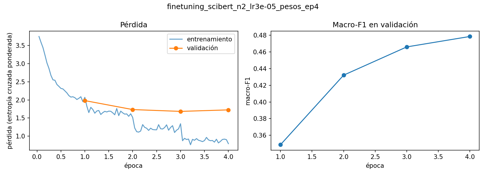
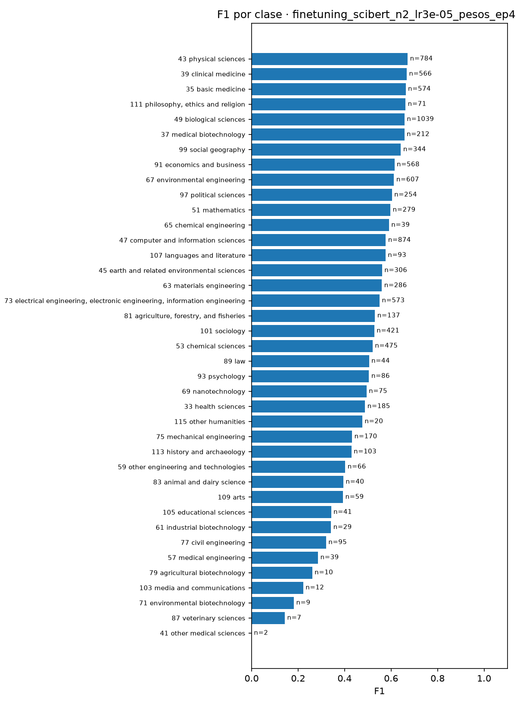
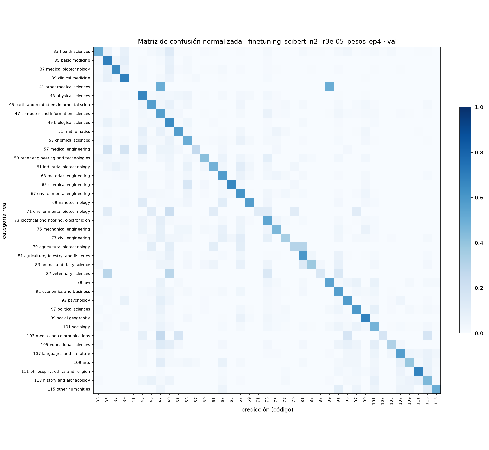

# Proyecto CORDIS

Trabajo de Tratamiento de Datos sobre clasificación de proyectos de investigación.
Queremos predecir el área científica de un proyecto a partir de su resumen y
comparar distintas representaciones y modelos.

**Estado:** resultados reales de validación de todos los modelos, con la
comparación conjunta y su incertidumbre. Las decisiones se han elegido con
validación. La evaluación final en test sigue pendiente.

## Cómo nos repartimos

Mónica hizo el cuaderno original, incluidos el inicio de la regresión logística
y el extractor BERT. Esa aportación sigue siendo suya aunque el código esté
repartido entre los tres cuadernos. Su carga nueva será menor para reconocer
ese trabajo previo.

| Persona | Archivos principales | Responsabilidad |
| --- | --- | --- |
| Mónica | `01_datos_y_representaciones.ipynb` | Revisar datos y etiquetas, generar TF-IDF y Word2Vec y explicar la exploración |
| Izan | `02_modelos_y_extension.ipynb` y `funciones.py` | Mantener las funciones, ajustar clasificadores, hacer la red y la extensión |
| Sara | `03_bert_y_comparacion.ipynb` | Completar BERT, hacer fine-tuning y comparar los resultados |

**Solo Izan edita `funciones.py`.** Mónica y Sara le comunican los ajustes que
necesiten. Los tres escriben sus apartados del README y preparan sus diapositivas.
Sara reúne el informe e Izan reúne las diapositivas. Las conclusiones se revisan
entre los tres. La declaración final de contribuciones reflejará lo que se haga
realmente, sin tratar la plantilla o los apartados pendientes como trabajo terminado.

El reparto detallado, las dependencias y el Gantt están en
`Reparto_y_calendario_CORDIS.pdf`.

## Qué hay en cada archivo

- `01_datos_y_representaciones.ipynb`: preparación, exploración, TF-IDF y Word2Vec.
- `02_modelos_y_extension.ipynb`: clasificadores ajustados, red propia y extensión ejecutados en validación; evaluación final en test desactivada.
- `03_bert_y_comparacion.ipynb`: BERT congelado, fine-tuning de BERT, tabla común de resultados, incertidumbre y análisis de errores.
- `funciones.py`: funciones que comparten los cuadernos; responsable único: Izan.
- `datos/`: Excel y vectores locales; quedan fuera de GitHub.
- `resultados/`: reparto de proyectos, métricas, predicciones y gráficas.
- `presentacion.md`: guion inicial para preparar las diapositivas.

El cuaderno original se conserva en su ubicación inicial fuera de esta carpeta.
El código existente de preparación, representaciones, BERT y primera regresión
logística se repartió entre estos archivos. Se limpiaron sus salidas al crear la
base; las salidas actuales de los cuadernos 02 y 03 corresponden a las ejecuciones
registradas en resultados/.

## Problema y datos
Durante la preparación del conjunto de datos se analizaron los valores ausentes y la disponibilidad de las etiquetas científicas EuroSciVoc.

El conjunto original contiene 35.378 proyectos H2020. Utilizamos `summary` como entrada del proyecto básico y construimos la etiqueta con `euroSciVocCode` y el catálogo `SciVocCodes.xlsx`.

Para cada proyecto recorremos sus códigos en el orden disponible y elegimos el primero cuyo camino tenga una categoría de nivel 2. Guardamos esa categoría y su raíz de nivel 1. Descartamos proyectos sin una categoría válida.

La preparación actual conserva 31.982 proyectos (90,40 %), con 39 categorías de nivel 2 y 6 de nivel 1. El reparto guardado contiene 19.189 proyectos de entrenamiento, 9.594 de validación y 3.199 de test.

**Comprobación del filtrado de proyectos:** Se ha revisado la diferencia entre el porcentaje de proyectos conservados por nuestra implementación (90,40 %) y el valor aproximado del 90,31 % indicado en el enunciado.
De los 35.378 proyectos originales:
- 3.326 proyectos no contienen información en euroSciVocCode.
- 32.052 proyectos contienen al menos un código EuroSciVoc.
- De estos, 70 proyectos adicionales se descartan porque sus códigos únicamente permiten identificar categorías de primer nivel, sin alcanzar una categoría válida de segundo nivel.
- Finalmente, se conservan 31.982 proyectos, equivalentes al 90,40 % del conjunto original.

Se ha comprobado que todos los códigos utilizados existen en el catálogo EuroSciVoc y que los 70 proyectos descartados no contienen ninguna categoría válida de segundo nivel. Por tanto, el procedimiento implementado sigue los criterios establecidos en el enunciado.

También se ha verificado que las particiones de entrenamiento, validación y prueba no presentan proyectos repetidos entre conjuntos, garantizando que los 31.982 proyectos son únicos.

## Análisis exploratorio de datos (EDA):
Se ha realizado un análisis exploratorio para estudiar las principales características del conjunto de datos, incluyendo valores ausentes, distribución de categorías, desequilibrio entre clases, longitud de los resúmenes, evolución temporal, distribución geográfica y vocabulario utilizado.

### Distribución de las categorías científicas
Los proyectos se distribuyen entre 6 categorías científicas de primer nivel y 39 categorías de segundo nivel.

La distribución de los proyectos entre las 39 categorías científicas de nivel 2 muestra un claro desequilibrio entre clases (ver siguiente figura).


Las categorías más frecuentes son Basic medicine (3.464 proyectos), Physical sciences (2.912 proyectos) y Computer and information sciences (2.613 proyectos). En cambio, otras categorías cuentan con un número muy reducido de ejemplos.

Este desequilibrio puede afectar al entrenamiento de los clasificadores, ya que los modelos pueden aprender a predecir mejor las categorías mayoritarias y presentar dificultades para identificar las minoritarias. Por este motivo, se utilizan dos métricas de evaluación:
- **Accuracy**: mide la proporción total de predicciones correctas, pero puede ofrecer resultados elevados cuando el modelo favorece las clases mayoritarias.
- **Macro-F1**: calcula el F1 de cada categoría y obtiene su media sin ponderar por el número de proyectos, dando la misma importancia a las clases mayoritarias y minoritarias.

Por tanto, macro-F1 se utiliza como métrica principal para comparar los modelos, mientras que accuracy se emplea como medida complementaria del rendimiento global.

También se han representado las diez categorías de segundo nivel con mayor número de proyectos mediante un gráfico circular. Los porcentajes de este gráfico corresponden únicamente a las diez categorías seleccionadas.


### Longitud de los resúmenes
Se ha analizado la longitud de los resúmenes para conocer la cantidad de información textual disponible para los modelos.


La longitud media es de aproximadamente 265 palabras, mientras que la mediana es de 276 palabras.
Estos resultados muestran que los proyectos suelen disponer de resúmenes relativamente extensos, lo que permite utilizar técnicas de representación textual como TF-IDF, Word2Vec y BERT. Sin embargo, las diferencias de longitud entre documentos pueden influir en las representaciones obtenidas.

### Distribución temporal de los proyectos
Se ha estudiado la distribución de los proyectos según su año de inicio.
El año 2019 presenta el mayor número de proyectos, con 4.799 registros.


La distribución temporal permite observar cómo varía el número de proyectos registrados a lo largo del periodo analizado.

### Distribución geográfica
Se ha analizado la distribución de los proyectos según el país coordinador.


Los países con mayor número de proyectos son:
- Reino Unido: 5.027 proyectos.
- España: 3.928 proyectos.
- Alemania: 3.464 proyectos.

Estos resultados muestran una concentración importante de proyectos en determinados países europeos.

### Análisis de palabras frecuentes
Se ha estudiado el vocabulario de los resúmenes para identificar los términos más habituales en las descripciones de los proyectos.

Entre las palabras frecuentes aparecen términos como *project, new, research, based y data*, relacionados con el carácter científico y tecnológico del conjunto de datos.

Se han generado dos visualizaciones: un gráfico de las palabras más frecuentes y una nube de palabras. Estas visualizaciones permiten conocer las características generales del vocabulario y observar la presencia de términos comunes en numerosos proyectos.


### Clasificador de referencia (Baseline)
Para establecer un punto de comparación inicial, se ha implementado un clasificador que predice siempre la categoría más frecuente del conjunto de entrenamiento, utilizando DummyClassifier con la estrategia most_frequent.

En el conjunto de validación, para la clasificación de nivel 2, se han obtenido los siguientes resultados:


La exactitud del 10,83 % refleja la proporción de proyectos pertenecientes a la categoría mayoritaria en validación. Sin embargo, el valor de macro-F1 es muy reducido, ya que el clasificador no consigue identificar correctamente las demás categorías.

Estos resultados evidencian el desequilibrio existente entre las clases y muestran que predecir siempre la categoría mayoritaria no es una estrategia adecuada para este problema.

Por tanto, el baseline servirá como punto de referencia para comparar el rendimiento de los modelos basados en TF-IDF, Word2Vec y BERT, que deberán superar estos valores para demostrar una mejora en la clasificación.

La evaluación sobre el conjunto de test se reserva para la fase final, una vez seleccionados los modelos y sus hiperparámetros mediante el conjunto de validación. De esta forma, se evita utilizar los datos de prueba durante la toma de decisiones y se obtiene una evaluación final independiente.

### Conclusiones del análisis exploratorio
El análisis exploratorio permite extraer las siguientes conclusiones:

**1. Desequilibrio entre categorías**: las 39 categorías de segundo nivel presentan frecuencias diferentes, lo que puede dificultar la clasificación de las clases minoritarias. Por ello, se utiliza macro-F1 para complementar la accuracy.

**2. Disponibilidad de información textual**: los resúmenes contienen una cantidad considerable de texto, lo que permite aplicar diferentes técnicas de representación y clasificación automática.

**3. Distribución temporal y geográfica**: el número de proyectos varía según el año y el país coordinador, con una mayor representación de determinados países europeos.

**4. Vocabulario científico**: los resúmenes presentan términos frecuentes relacionados con la investigación, la innovación y el desarrollo tecnológico. Esto hace necesario utilizar representaciones que permitan distinguir los términos más informativos de cada categoría.

**5. Necesidad de modelos más avanzados**: el clasificador de clase mayoritaria obtiene un rendimiento muy limitado, especialmente en macro-F1, por lo que resulta necesario evaluar modelos basados en TF-IDF, Word2Vec y BERT.

En conclusión, el EDA permite comprender las características del problema y proporciona una base para interpretar los resultados de los modelos de clasificación.

Todas las gráficas se encuentran disponibles en resultados/graficas/ y pueden visualizarse directamente desde este README sin necesidad de ejecutar los cuadernos.


## Método

### Entrenamiento, validación y test

Se mantiene el reparto del cuaderno original: 60 % entrenamiento, 30 % validación
y 10 % test, con semilla 42 y estratificación por la etiqueta de nivel 2.
`resultados/particiones.csv` guarda los identificadores, etiquetas y orden.
Los tres cuadernos reutilizan ese archivo y avisan si los datos ya no coinciden.

El vocabulario, los embeddings entrenados con el corpus, la imputación y el
escalado se ajustan únicamente con entrenamiento. Los hiperparámetros se eligen
con validación; el test se reserva para el final.

### Representaciones

- **TF-IDF:** lematización con spaCy, minúsculas y eliminación de stopwords,
  números y tokens de hasta dos caracteres. Como configuración inicial:
  `max_features=10000`, `min_df=5`, `max_df=0.90` y unigramas/bigramas.
- **Word2Vec:** entrenado únicamente con los textos de entrenamiento. La base
  usa 300 dimensiones, ventana 5, `min_count=2`, skip-gram y 10 épocas.
  Usamos un trabajador y semilla 42 para facilitar la repetición. Promediamos
  las palabras conocidas; si no hay ninguna, devolvemos ceros. El cuaderno
  calcula cuántas palabras quedan fuera de vocabulario y cuántos documentos
  carecen de un vector utilizable.
- **BERT congelado (Sara):** `bert-base-uncased` usado solo como extractor de
  características: modo evaluación, sin gradientes y con los pesos sin cambiar. La
  entrada es el `summary` original, sin el preprocesamiento de spaCy, porque BERT
  tiene su propio tokenizador y aprovecha el contexto completo. Cada resumen se
  representa con la **media de los vectores de la última capa** de todos sus tokens
  reales: la máscara de atención excluye el padding, y la media incluye `[CLS]` y `[SEP]`.
  Así se obtienen 768 dimensiones. Se prefiere la media al vector de `[CLS]` porque, sin
  fine-tuning, `[CLS]` no está entrenado para resumir el documento.
  Los textos de más de 512 tokens se truncan. Lo hemos **medido**: la mediana es de
  366 tokens, el percentil 95 de 423, y solo 28 de 31.982 resúmenes (0,09 %) superan
  el límite, así que no compensa dividirlos en ventanas. La extracción completa
  tardó 16,5 minutos en una GPU T4 (configuración en
  `resultados/bert_congelado_config.json`). Los vectores se guardan en
  `datos/cache/bert.joblib`, fuera de GitHub, con una huella que comprueba los proyectos y su orden.

### Resultados de TF-IDF y Word2Vec
Se han generado las representaciones TF-IDF y Word2Vec utilizando los resúmenes preprocesados de los proyectos y las particiones compartidas.

El vocabulario de TF-IDF y los embeddings de Word2Vec se han aprendido exclusivamente con el conjunto de entrenamiento, evitando utilizar información de validación o prueba durante su construcción.

Las dimensiones obtenidas son:


TF-IDF representa cada proyecto mediante un vector disperso de 10.000 características, mientras que Word2Vec utiliza vectores densos de 300 dimensiones, obtenidos promediando las representaciones de las palabras conocidas.

#### Análisis de palabras fuera del vocabulario (OOV)
Se ha analizado la proporción de palabras que no aparecen en el vocabulario aprendido por Word2Vec.


Los porcentajes OOV son relativamente bajos, lo que indica que el vocabulario aprendido permite representar la mayoría de los tokens de los documentos.

En validación y prueba el porcentaje OOV es superior porque pueden aparecer términos no presentes en el conjunto de entrenamiento.

Se ha identificado un documento de validación sin palabras reconocidas por Word2Vec. Para mantener las dimensiones de las matrices, se representa mediante un vector de 300 ceros.

#### Limitaciones de las representaciones
TF-IDF permite identificar términos relevantes, pero no representa directamente las relaciones semánticas entre palabras.

Word2Vec captura relaciones entre términos mediante embeddings, aunque el promedio de vectores puede perder información sobre el orden de las palabras y el contexto específico del documento.

Además, las palabras fuera del vocabulario no contribuyen a la representación Word2Vec, lo que puede provocar pérdida de información en determinados proyectos.

### Modelos

Ya está trasladada la primera regresión logística con TF-IDF.

**Modelos de Izan.** Se ajusta regresión logística con TF-IDF, Word2Vec y BERT
congelado, manteniendo los mismos proyectos y la misma búsqueda: `C` en
`[0.5, 2.0]`, con y sin `class_weight="balanced"`. Se usa `lbfgs`, hasta 600
iteraciones y tolerancia 0,001. Se elige por macro-F1 de validación; no se ha usado
test. Word2Vec y BERT se estandarizan con train; TF-IDF permanece disperso y con
su normalización del vectorizador. Se repite la búsqueda en niveles 1 y 2.

La red propia de PyTorch usa Word2Vec, una capa oculta ReLU y dropout. Se prueban
128 neuronas, dropout 0,2 y tasa 0,001, y 256 neuronas, dropout 0,3 y tasa 0,0005.
Se entrena con Adam, lotes de 256 y entropía cruzada ponderada por la frecuencia
inversa de las clases de train, hasta 30 épocas. Se detiene tras cinco épocas sin
mejora en macro-F1 de validación y se recupera la mejor época. El escalado y el
mapeo de categorías se aprenden solo con train. Se repite en nivel 1.

Las representaciones TF-IDF y Word2Vec se regeneraron localmente con las
funciones y parámetros iniciales de Mónica; BERT se cargó desde la caché de Sara.
Las versiones efectivas están en `resultados/entorno_izan.json`, las búsquedas en
`busqueda_lr_izan.csv` y `busqueda_red_izan.csv`, y las configuraciones elegidas en
`resultados/configuraciones_izan.json`.

**Fine-tuning de BERT (Sara).** A diferencia de BERT congelado, aquí se
actualizan todos los pesos del Transformer con las etiquetas del problema. Se usa
`AutoModelForSequenceClassification` de Hugging Face: el mismo `bert-base-uncased`
más una capa lineal sobre `[CLS]`. Usar el mismo modelo base que en la versión
congelada permite atribuir la diferencia a la adaptación de los pesos.

- Entrada: el `summary` original, `max_length=512` (truncamiento despreciable,
  ver arriba) y padding por lote. Mismas particiones que el resto del grupo.
- Etiquetas: los códigos EuroSciVoc se convierten en índices 0…K−1 con las clases de
  train. El mapeo se guarda en `resultados/finetuning_mapeo_nivel{N}.json`.
- Entrenamiento: AdamW, lote 16, 3 épocas, decaimiento de pesos 0,01, calentamiento
  lineal del 10 % de los pasos, fp16 y semilla 42, en una GPU T4 (Colab para la
  versión original; Kaggle para las mejoras). Estos valores están dentro de los rangos
  que recomiendan Devlin et al. (2019) para BERT.
- Selección: evaluación en validación al final de cada época, conservando la de
  mejor macro-F1. Entre tasas de aprendizaje también se elige por macro-F1 en
  validación. El test no interviene.

**Mejoras tras la comparación conjunta.** La primera versión dejaba 9 categorías
pequeñas con F1 = 0 y perdía en macro-F1 frente a TF-IDF con pesos de clase (ver la
comparación conjunta). Por eso se probaron, eligiendo otra vez con validación:

- **Pesos de clase** en la entropía cruzada: la raíz cuadrada de los pesos inversos a
  la frecuencia de train, normalizados para que la pérdida media no cambie de escala.
  Con los pesos inversos puros la clase más pequeña (6 proyectos en train) pesaría unas
  350 veces más que la más frecuente; con la raíz, unas 19 veces (de 0,57 a 10,69).
- **SciBERT** (`allenai/scibert_scivocab_uncased`, Beltagy et al., 2019): la misma
  arquitectura que BERT, preentrenada con artículos científicos y con vocabulario propio.
- **4 épocas**, porque el macro-F1 seguía subiendo en la tercera; se conserva igualmente
  la mejor época según validación.

El plan se ejecutó de forma automática en Kaggle (cuaderno 03, `EJECUTAR_PLAN_MEJORAS`):
primero BERT con pesos; después SciBERT con la opción de pesos que mejor funcionó con
BERT; y la mejor configuración de nivel 2, repetida en nivel 1.

| Nivel | Modelo base | Pesos de clase | Tasa | Épocas | Mejor época | Accuracy val | Macro-F1 val | Minutos |
| ---: | --- | --- | ---: | ---: | ---: | ---: | ---: | ---: |
| 2 | BERT | No | 2e-5 | 3 | 3 | 0,573 | 0,338 | 29,5 |
| 2 | BERT | No | 3e-5 | 3 | 3 | 0,585 | 0,370 | 32,0 |
| 2 | BERT | Sí (raíz) | 3e-5 | 4 | 4 | 0,585 | 0,460 | 35,7 |
| 2 | SciBERT | Sí (raíz) | 3e-5 | 4 | 4 | 0,588 | 0,479 | 34,1 |
| 1 | BERT | No | 3e-5 | 3 | 3 | 0,715 | 0,676 | 34,3 |
| 1 | SciBERT | Sí (raíz) | 3e-5 | 4 | 3 | 0,711 | 0,675 | 34,0 |

Configuración elegida en **nivel 2: SciBERT con pesos de clase**, la de mayor macro-F1
en validación. Las mejoras frente a la versión original, con el bootstrap pareado:

- **Pesos de clase** (BERT con pesos − original): macro-F1 +0,091; IC 95 %: 0,071 a 0,107, significativo; la accuracy no
  cambia (+0,000; IC 95 %: -0,007 a 0,007). La mejora no se debe a
  la cuarta época: en la tercera, BERT con pesos ya tenía 0,453 de macro-F1, frente a 0,370.
- **SciBERT** (SciBERT − BERT, ambos con pesos): macro-F1 +0,018; IC 95 %: 0,002 a 0,034, significativo pero
  pequeño; la accuracy empata (+0,003; IC 95 %: -0,005 a 0,012).
- En total (SciBERT con pesos − original): macro-F1 +0,109; IC 95 %: 0,089 a 0,126 con la
  misma accuracy (+0,003; IC 95 %: -0,005 a 0,012).

En **nivel 1 se mantiene el BERT original**: SciBERT con pesos empata con él
(macro-F1 -0,001; IC 95 %: -0,013 a 0,010). Con 6 clases no hay categorías casi vacías que
rescatar, así que los pesos aportan poco.

La tasa 3e-5 se eligió antes frente a 2e-5 por macro-F1 en validación (+0,031,
significativo; IC 95 % de 0,023 a 0,040). Como la misma validación se ha usado para
elegir entre todas estas opciones, las cifras de las configuraciones elegidas pueden ser
algo optimistas; la estimación sin sesgo será la de test. Detalle en
`resultados/finetuning_busqueda_nivel{1,2}.csv`; historiales completos en
`resultados/finetuning_*_historial.json`.

Hay que anotar los parámetros que se prueban, la configuración elegida y los
detalles de entrenamiento. Si se usa validación cruzada, el vectorizador y las
demás transformaciones aprendidas se reajustan dentro de cada partición.

## Resultados y discusión

> **Estado:** resultados **en validación** de Izan y Sara, con la comparación
> pareada integrada en el cuaderno 03. Falta la evaluación final en test, que se
> hará con las decisiones cerradas.

La tabla común `resultados/metricas.csv` la genera el cuaderno 03. Reúne
`metricas_monica.csv`, `metricas_izan.csv` y `metricas_sara.csv`, si existen, y el
baseline de clase mayoritaria calculado con los mismos proyectos.

### Modelos de Izan en validación

Todos se evaluaron sobre los mismos 9.594 proyectos que Sara. Se guardaron las
predicciones con `projectID,nivel,conjunto,y_real,y_pred`, por lo que pueden
incorporarse directamente al análisis pareado del cuaderno 03.

| Modelo | Representación | Nivel | Accuracy val | Macro-F1 val |
| --- | --- | ---: | ---: | ---: |
| Red propia PyTorch | Word2Vec | 2 | 0.4074 | 0.3144 |
| Regresión logística | BERT congelado | 2 | 0.4081 | 0.2689 |
| Regresión logística | TF-IDF | 2 | 0.4908 | 0.3954 |
| Regresión logística | Word2Vec | 2 | 0.4437 | 0.2933 |
| Red propia PyTorch | Word2Vec | 1 | 0.6165 | 0.5766 |
| Regresión logística | BERT congelado | 1 | 0.6357 | 0.5754 |
| Regresión logística | TF-IDF | 1 | 0.6650 | 0.6256 |
| Regresión logística | Word2Vec | 1 | 0.6369 | 0.5747 |

La mejor configuración básica de Izan por macro-F1 de validación es
`izan_lr_tfidf_n2` (0.3954). Esta es una selección sobre
validación y puede resultar optimista. Las diferencias no se interpretan como
significativas sin la comparación pareada de Sara y la evaluación final en test.


La red muestra una pérdida de entrenamiento que sigue bajando mientras la de
validación se estanca y después aumenta. Se conserva la época de mayor macro-F1
de validación (15 en nivel 2 y 6 en nivel 1), no la última época ejecutada.
Para TF-IDF y `C=2`, ponderar las clases cambia la accuracy de 0,5152 a 0,4908,
pero sube el macro-F1 de 0,3322 a 0,3954. Esto muestra el compromiso entre la
accuracy global y el peso de las categorías pequeñas en nuestra métrica principal.

Para comparar el efecto de la representación entre niveles se utiliza únicamente
regresión logística, manteniendo el mismo clasificador. La red, el fine-tuning y
la extensión se analizan aparte. El detalle está en
`resultados/ranking_representaciones_izan_val.csv`.

TF-IDF ocupa el primer puesto de regresión logística en las dos estimaciones.
Word2Vec y BERT congelado intercambian su orden puntual, pero en nivel 1 su
diferencia de macro-F1 es solo 0,0007; el intercambio no se interpreta como una
ventaja clara sin contrastar su incertidumbre.


Los resultados completos están en `resultados/metricas_izan.csv`; los desgloses
por clase en `resultados/izan_por_clase_*_val.csv` y las predicciones en
`resultados/predicciones/izan_*_val.csv`. Los historiales de la red conservan
todas las épocas ejecutadas para las dos configuraciones, no solo la ganadora.

### Fine-tuning de BERT (validación)

| Modelo | Nivel | Accuracy val (IC 95 %) | Macro-F1 val (IC 95 %) |
| --- | ---: | --- | --- |
| **SciBERT con pesos de clase, 4 épocas (elegido)** | 2 | 0,588 (0,579–0,598) | 0,479 (0,458–0,496) |
| BERT con pesos de clase, 4 épocas | 2 | 0,585 (0,575–0,594) | 0,460 (0,441–0,476) |
| BERT original, tasa 3e-5 | 2 | 0,585 (0,575–0,594) | 0,370 (0,358–0,380) |
| BERT original, tasa 2e-5 | 2 | 0,573 (0,563–0,581) | 0,338 (0,328–0,347) |
| Baseline: clase mayoritaria | 2 | 0,108 (0,102–0,114) | 0,005 (0,005–0,005) |
| **BERT original, tasa 3e-5 (elegido)** | 1 | 0,715 (0,706–0,724) | 0,676 (0,662–0,689) |
| SciBERT con pesos de clase, 4 épocas | 1 | 0,711 (0,702–0,720) | 0,675 (0,660–0,689) |
| Baseline: clase mayoritaria | 1 | 0,392 (0,382–0,402) | 0,094 (0,092–0,096) |

Los intervalos son bootstrap con 1.000 remuestreos de los proyectos de validación.



**Lectura de las curvas (SciBERT con pesos, nivel 2):** el macro-F1 de validación sube en
las cuatro épocas (0,349 → 0,432 → 0,466 → 0,479) y se conserva la cuarta. La pérdida de validación
(ponderada) es mínima en la tercera época y sube un poco en la cuarta (1,982 → 1,734 → 1,684 → 1,726): el
modelo empieza a confiar demasiado en algunas predicciones, pero sigue acertando más clases,
y el criterio de selección es el macro-F1. Más épocas probablemente ya no compensarían.
Esta pérdida va ponderada por clase, así que no se compara con la de la versión original:


En la versión original, sin pesos, la pérdida de validación bajaba en las tres épocas y el
macro-F1 seguía subiendo al final.

### Incertidumbre y criterio para comparar

Con un único conjunto de evaluación, las métricas dependen de qué proyectos han
caído en él. Para la accuracy, la mitad del intervalo del 95 % es aproximadamente
**±1 punto en validación (9.594 proyectos) y ±1,7 puntos en test (3.199)**. El
macro-F1 es más ruidoso, porque varias clases tienen muy pocos ejemplos: la clase 41
tiene 2 en validación y 1 en test. Para comparar dos modelos usamos un **bootstrap
pareado**: en cada remuestreo, los mismos proyectos para los dos modelos, unidos por
`projectID`. Una diferencia solo se considera real si su intervalo del 95 % **no
contiene el 0**. Si lo contiene, se informa como empate. Los resultados están en
`resultados/intervalos_val.csv` y `resultados/diferencias_val.csv`.

### Dónde falla el modelo (finetuning_scibert_n2_lr3e-05_pesos_ep4, validación)



- **Clases pequeñas:** con los pesos de clase, las categorías con F1 = 0 pasan de
  9 en la versión original a **1**: solo queda *otras ciencias médicas* (código 41), con
  2 proyectos en validación. Las otras 8 que antes no se predecían nunca
  (ingeniería química, ingeniería médica, biotecnología industrial, ciencias
  veterinarias…) ahora tienen F1 entre 0,14 y 0,59. A cambio, las categorías
  grandes (500 proyectos o más) bajan como mucho 0,021 de F1. Por eso sube
  el macro-F1 sin que cambie la accuracy. Aun así, el macro-F1 (0,479) queda
  por debajo de la accuracy (0,588): las categorías con pocos ejemplos siguen
  siendo las más difíciles.



- **Confusiones entre categorías relacionadas:** el 34,8 % de los errores
  cae en una categoría hermana (misma raíz de nivel 1). Si el modelo eligiese la
  categoría equivocada al azar, con la frecuencia con que predice cada una, sería
  el 21,2 %. Las confusiones más frecuentes son entre medicina
  básica, medicina clínica y ciencias biológicas, y entre informática e ingeniería
  eléctrica y electrónica. Varias de estas parejas tienen raíces distintas en EuroSciVoc
  (por ejemplo, informática está en ciencias naturales e ingeniería eléctrica en
  ingeniería), pero sus temas están muy próximos en la práctica.
- **Ambigüedad de la etiqueta:** el **53,9 % de los errores** consiste
  en predecir otra de las categorías válidas del proyecto, que descartamos al quedarnos
  solo con la primera. Si esas predicciones contaran como acierto, la accuracy pasaría
  de 0,588 a **0,810**. Una parte grande del error medido
  se debe, por tanto, a la elección de una sola etiqueta y no a un fallo real del
  modelo, lo que confirma el techo del que habla el enunciado.

Detalle por clase y lista de errores en `resultados/por_clase_*_val.csv` y
`resultados/errores_*_val.csv` (también los de la versión original, para comparar).

### Nivel 1: seis categorías (finetuning_bert_n1_lr3e-05, validación)

Se repitió la mejor configuración (tasa 3e-5) con las 6 raíces de EuroSciVoc. También se
probó en nivel 1 la mejor de las mejoras (SciBERT con pesos de clase): empata con el BERT
original (accuracy 0,711 frente a 0,715; macro-F1 0,675 frente a 0,676;
diferencias no significativas), así que en nivel 1 se mantiene el original.


- Frente al modelo elegido de nivel 2, el macro-F1 pasa de 0,479 (39 clases) a **0,676** (6 clases), y la
  accuracy de 0,588 a **0,715**. Con categorías más amplias hay muchos
  más ejemplos por clase y desaparecen las clases casi vacías: el F1 por clase va de
  0,53 (ciencias agrícolas, la raíz más pequeña) a 0,75.
- La pérdida de validación sube ligeramente en la tercera época (0,809 → 0,762 → 0,796), aunque el
  macro-F1 sigue mejorando. Se conserva la época 3 porque el criterio de selección es
  el macro-F1.
- El **62,3 % de los errores** es otra raíz válida del proyecto. Si esas
  predicciones contaran como acierto, la accuracy sería 0,893. Las confusiones más
  frecuentes son entre ciencias naturales e ingeniería, en los dos sentidos, y entre
  ciencias naturales y medicina: áreas muy solapadas en proyectos interdisciplinares.
- **Ranking de representaciones:** ver la comparación conjunta a continuación.

### Comparación conjunta (validación)

Todos los modelos se evaluaron con los mismos 9.594 proyectos de validación. Los
intervalos del 95 % se obtienen con bootstrap (1.000 remuestreos) y las diferencias,
con el bootstrap pareado descrito arriba. Las tablas completas están en
`resultados/metricas.csv`, `resultados/intervalos_val.csv` y `resultados/diferencias_val.csv`.

| Modelo | Nivel 2: accuracy | Nivel 2: macro-F1 | Nivel 1: accuracy | Nivel 1: macro-F1 |
| --- | ---: | ---: | ---: | ---: |
| **Fine-tuning elegido** (n2: SciBERT con pesos; n1: BERT original) | 0,588 (0,579–0,598) | 0,479 (0,458–0,496) | 0,715 (0,706–0,724) | 0,676 (0,662–0,689) |
| BERT fine-tuning original (tasa 3e-5, sin pesos) | 0,585 (0,575–0,594) | 0,370 (0,358–0,380) | 0,715 (0,706–0,724) | 0,676 (0,662–0,689) |
| TF-IDF + regresión logística | 0,491 (0,480–0,500) | 0,395 (0,376–0,412) | 0,665 (0,655–0,674) | 0,626 (0,612–0,638) |
| Word2Vec + regresión logística | 0,444 (0,434–0,454) | 0,293 (0,280–0,305) | 0,637 (0,627–0,647) | 0,575 (0,558–0,591) |
| BERT congelado + regresión logística | 0,408 (0,398–0,417) | 0,269 (0,256–0,280) | 0,636 (0,626–0,645) | 0,575 (0,561–0,590) |
| Word2Vec + red propia (PyTorch) | 0,407 (0,397–0,417) | 0,314 (0,302–0,326) | 0,617 (0,607–0,627) | 0,577 (0,564–0,588) |
| TF-IDF + metadatos + reg. logística (extensión) | 0,486 (0,476–0,496) | 0,373 (0,358–0,386) | — | — |
| Solo metadatos + reg. logística (extensión) | 0,135 (0,128–0,142) | 0,025 (0,023–0,026) | — | — |
| Baseline: clase mayoritaria | 0,108 (0,102–0,114) | 0,005 (0,005–0,005) | 0,392 (0,382–0,402) | 0,094 (0,092–0,096) |

**Comparaciones pareadas (A − B).** "Sí" significa que el intervalo del 95 % de la
diferencia no contiene el 0.

| Pregunta | Nivel | Δ accuracy (IC 95 %) | ¿Sig.? | Δ macro-F1 (IC 95 %) | ¿Sig.? |
| --- | ---: | --- | :---: | --- | :---: |
| BERT original (sin pesos): fine-tuning − congelado con reg. logística | 2 | +0,177 (0,166 a 0,187) | Sí | +0,101 (0,087 a 0,115) | Sí |
| BERT: fine-tuning − congelado con reg. logística | 2 | +0,180 (0,169 a 0,192) | Sí | +0,210 (0,189 a 0,229) | Sí |
| BERT: fine-tuning − congelado con reg. logística | 1 | +0,079 (0,070 a 0,089) | Sí | +0,100 (0,085 a 0,116) | Sí |
| Extensión: TF-IDF + metadatos − solo TF-IDF | 2 | -0,004 (-0,009 a 0,000) | No | -0,023 (-0,038 a -0,006) | Sí |
| Fine-tuning − TF-IDF con reg. logística | 2 | +0,098 (0,087 a 0,108) | Sí | +0,083 (0,064 a 0,102) | Sí |
| Fine-tuning − TF-IDF con reg. logística | 1 | +0,050 (0,042 a 0,059) | Sí | +0,050 (0,038 a 0,064) | Sí |
| Fine-tuning: SciBERT − BERT (ambos con pesos de clase) | 2 | +0,003 (-0,005 a 0,012) | No | +0,018 (0,002 a 0,034) | Sí |
| Fine-tuning: tasa 3e-5 − 2e-5 | 2 | +0,012 (0,007 a 0,018) | Sí | +0,031 (0,023 a 0,040) | Sí |
| Mejora: BERT con pesos − original | 2 | +0,000 (-0,007 a 0,007) | No | +0,091 (0,071 a 0,107) | Sí |
| Mejora: SciBERT con pesos − original | 2 | +0,003 (-0,005 a 0,012) | No | +0,109 (0,089 a 0,126) | Sí |
| Mejora: SciBERT con pesos − original | 1 | -0,004 (-0,012 a 0,003) | No | -0,001 (-0,013 a 0,010) | No |
| Representación (reg. logística): TF-IDF − BERT congelado | 2 | +0,083 (0,072 a 0,093) | Sí | +0,126 (0,106 a 0,146) | Sí |
| Representación (reg. logística): TF-IDF − BERT congelado | 1 | +0,029 (0,020 a 0,038) | Sí | +0,050 (0,037 a 0,064) | Sí |
| Representación (reg. logística): TF-IDF − Word2Vec | 2 | +0,047 (0,038 a 0,056) | Sí | +0,102 (0,082 a 0,121) | Sí |
| Representación (reg. logística): TF-IDF − Word2Vec | 1 | +0,028 (0,019 a 0,037) | Sí | +0,051 (0,036 a 0,065) | Sí |
| Representación (reg. logística): Word2Vec − BERT congelado | 2 | +0,036 (0,026 a 0,046) | Sí | +0,024 (0,012 a 0,037) | Sí |
| Representación (reg. logística): Word2Vec − BERT congelado | 1 | +0,001 (-0,008 a 0,010) | No | -0,001 (-0,017 a 0,015) | No |
| Word2Vec: red propia − reg. logística | 2 | -0,036 (-0,046 a -0,027) | Sí | +0,021 (0,009 a 0,036) | Sí |
| Word2Vec: red propia − reg. logística | 1 | -0,020 (-0,029 a -0,011) | Sí | +0,002 (-0,013 a 0,016) | No |

En las filas "Fine-tuning − …", el fine-tuning es el elegido en cada nivel (SciBERT con
pesos en nivel 2; BERT original en nivel 1).

**Lectura:**

- **Ranking de representaciones (mismo clasificador, regresión logística).** TF-IDF es
  la mejor en los dos niveles, con diferencias significativas frente a las otras dos.
  En nivel 2, Word2Vec supera a BERT congelado (+0,024 de macro-F1,
  significativo). En nivel 1 quedan empatadas (-0,001, con un
  intervalo que contiene el 0). Por tanto, **el ranking no cambia de forma interpretable
  con la granularidad**: el único cambio de puesto, entre Word2Vec y BERT en nivel 1,
  está dentro del ruido. Que BERT congelado quede por detrás de TF-IDF es razonable. La
  media de los vectores de un BERT no adaptado mezcla información general del lenguaje,
  mientras que TF-IDF conserva términos técnicos muy discriminativos para el área científica.
- **Adaptar BERT compensa.** Con el mismo modelo base y sin pesos, el fine-tuning mejora a
  BERT congelado con regresión logística en +0,101 de macro-F1 en nivel 2 y +0,100 en
  nivel 1. Con los pesos de clase y SciBERT, la ventaja en nivel 2 llega a +0,210. Es la mayor
  ganancia del estudio.
- **Fine-tuning frente al mejor modelo clásico.** El fine-tuning elegido es mejor que
  TF-IDF con regresión logística **en las dos métricas y en los dos niveles**, con
  diferencias significativas: en nivel 2, +0,098 de accuracy y +0,083 de macro-F1; en
  nivel 1, +0,050 y +0,050. La versión original de nivel 2, sin pesos de clase, ganaba
  en accuracy pero perdía en macro-F1 (−0,026, significativo): dejaba 9 categorías con
  F1 = 0, frente a 1 de la regresión logística con `class_weight="balanced"`. Ponderar
  la pérdida del fine-tuning corrigió ese problema, que venía del desbalance y no de la
  representación.
- **Red propia frente a regresión logística con Word2Vec.** En nivel 2 la red sube el
  macro-F1 (+0,021) pero baja la accuracy (-0,036), lo que encaja con su
  pérdida ponderada por clases. En nivel 1 el macro-F1 empata (+0,002). La red no aporta
  una mejora clara frente al modelo lineal.
- **Extensión.** Añadir metadatos a TF-IDF **empeora** el macro-F1 de forma significativa
  (-0,023), y la accuracy queda empatada (-0,004). Los metadatos solos superan
  al baseline, pero por muy poco: coste, duración o país dicen poco del área científica.

**Análisis de errores comparado** (`resultados/resumen_errores_val.csv`):

| | Fine-tuning elegido, nivel 2 | TF-IDF + reg. log., nivel 2 | Fine-tuning elegido, nivel 1 | TF-IDF + reg. log., nivel 1 |
| --- | ---: | ---: | ---: | ---: |
| Errores | 3.949 | 4.885 | 2.735 | 3.214 |
| Clases con F1 = 0 | 1 | 1 | 0 | 0 |
| % de errores que son otra categoría válida del proyecto | 53,9 | 51,1 | 62,3 | 61,3 |
| Accuracy estricta | 0,588 | 0,491 | 0,715 | 0,665 |
| Accuracy si contara cualquier categoría válida | 0,810 | 0,751 | 0,893 | 0,870 |
| % de errores entre categorías hermanas | 34,8 | 34,4 | — | — |
| % esperado si el error fuese al azar | 21,2 | 20,3 | — | — |

Los dos tipos de modelo fallan de forma parecida. Con pesos de clase, el fine-tuning ya
deja tantas categorías sin predecir como la regresión logística (una, la de 2 proyectos
en validación) y comete casi mil errores menos en nivel 2. Alrededor de la mitad de los
errores (más del 60 % en nivel 1) son otra categoría válida del proyecto, y un tercio de
los errores de nivel 2 cae en una categoría hermana, frente a un 20–21 % esperable por
azar. Las confusiones más frecuentes son las mismas en los dos modelos (medicina básica,
medicina clínica y ciencias biológicas; informática e ingeniería eléctrica). La ambigüedad de quedarnos con una única etiqueta limita a todos los modelos por igual.

Pendiente:

- Evaluar en test las configuraciones elegidas, una vez cerradas las decisiones, y repetir
  con `CONJUNTO = "test"` la tabla, las comparaciones pareadas y el análisis de errores.

## Extensión

Se compararon regresión logística con solo TF-IDF, solo metadatos y ambas
entradas concatenadas, usando los mismos proyectos y las mismas cuatro opciones
de ajuste. Se fijó TF-IDF como texto de esta extensión para aislar la aportación
de los metadatos sin añadir una nueva selección entre representaciones.

Los metadatos son logaritmo de coste y financiación europea, duración en días,
número de países participantes y país coordinador. Los ausentes numéricos se
imputan con la mediana de train y se estandarizan; el país se codifica con
one-hot aprendido en train, ignorando categorías nuevas. No se usan identificadores,
etiquetas EuroSciVoc ni campos que reproduzcan el objetivo. Los proyectos con
metadatos ausentes se conservan para mantener comparaciones sobre las mismas filas.

| Entrada | Accuracy val | Macro-F1 val |
| --- | ---: | ---: |
| TF-IDF | 0.4908 | 0.3954 |
| Metadatos | 0.1347 | 0.0246 |
| TF-IDF + metadatos | 0.4863 | 0.3729 |


Con esta concatenación y esta búsqueda, añadir metadatos no mejora la estimación
de TF-IDF solo: el macro-F1 pasa de 0,3954 a 0,3729. Los metadatos por sí solos
alcanzan 0,0246, frente al 0,0050 del baseline de clase mayoritaria. Es un resultado
negativo para la combinación empleada, útil para delimitar qué aporta el texto.

Son resultados de validación después de elegir hiperparámetros. La comparación
cuantifica lo obtenido con cada entrada en este protocolo; no demuestra una
ventaja significativa sin analizar sus diferencias. Las predicciones de las tres
opciones están disponibles para el bootstrap pareado de Sara. La evaluación
final de la extensión en test sigue pendiente.

## Conclusiones y limitaciones

> **Borrador preparado por Sara con los resultados de validación, pendiente de
> revisión por los tres y de confirmar con la evaluación final en test.**

- **El texto basta para predecir el área con bastante acierto, pero hay un techo.** El
  mejor modelo acierta el 59 % de las 39 categorías de nivel 2 y el 71 % de las 6 de
  nivel 1, frente al 11 % y el 39 % de la clase mayoritaria. Más de la mitad de los
  errores son otra categoría válida del proyecto. La elección de una única etiqueta,
  y no solo el modelo, limita la accuracy medible.
- **Representaciones.** Con el mismo clasificador, TF-IDF es la mejor en los dos
  niveles. Word2Vec y BERT congelado quedan por detrás, y su orden entre ellas no es
  estable con la granularidad (empatan en nivel 1). Un BERT sin adaptar, promediado,
  no supera a una representación dispersa bien ajustada.
- **Modelos.** El fine-tuning es el mejor modelo en las dos métricas y en los dos
  niveles, con diferencias significativas frente a TF-IDF con regresión logística. En
  nivel 2 eso solo ocurrió al ponderar las clases en la pérdida: la primera versión,
  sin pesos, perdía en macro-F1 frente a TF-IDF. SciBERT, preentrenado con texto
  científico, añade una mejora pequeña pero significativa (+0,018 de macro-F1). La red
  propia no mejora con claridad a la regresión logística.
- **Desbalance.** Es la limitación principal. Varias categorías tienen menos de 40
  ejemplos en validación, y los modelos que no ponderan las clases no llegan a
  predecirlas. En la regresión logística, ponderar cambia accuracy por macro-F1; en el
  fine-tuning, la ponderación suavizada (raíz de los pesos) sube el macro-F1 en
  +0,091 sin perder accuracy. Aun así, la categoría más pequeña (2 proyectos en
  validación) sigue sin acertarse.
- **Extensión.** Los metadatos administrativos (coste, duración, países) aportan muy
  poco y, combinados con TF-IDF, empeoran ligeramente el macro-F1.
- **Limitaciones.** Hiperparámetros y mejoras elegidos con validación, con búsquedas
  pequeñas por el coste de GPU; un único reparto con una sola semilla; resultados de validación, que
  pueden ser algo optimistas para las configuraciones elegidas; y etiquetas en parte
  generadas automáticamente y revisadas por expertos.

## Para ejecutar

Abrir una terminal en esta carpeta y usar un entorno de Python compatible con
las dependencias; Python 3.12 es una opción para empezar:

```powershell
python -m pip install -r requirements.txt
python -m spacy download en_core_web_sm
python -m jupyter lab
```

El comando `python` debe corresponder al entorno en el que se quiera trabajar.
Los dos Excel van en `datos/`. Consultar `datos/README.md`.

1. Acordar los datos y las particiones; Izan revisa las funciones comunes.
2. Mónica ejecuta el cuaderno 1 y Sara puede ejecutar el 3 en paralelo: BERT
   necesita los resúmenes originales, no los vectores de Mónica.
3. Izan prepara su código y los metadatos desde el principio y ejecuta los
   clasificadores conforme recibe los vectores de Mónica y Sara.
4. Sara hace fine-tuning en paralelo a los modelos de Izan y reúne al final
   las comparaciones. La evaluación final en test se hace tras cerrar los ajustes.

Las partes pendientes están escritas como tareas. El cálculo completo de BERT
requiere activar `GENERAR_TODO` en su cuaderno. No hace falta ejecutarlo para
abrir el proyecto. Para Colab hay que proporcionar los mismos datos,
`funciones.py` y el CSV de particiones, y situarse en la carpeta del proyecto.

`requirements.txt` es una lista inicial; antes de entregar hay que guardar las
versiones del entorno con el que se hayan reproducido los experimentos finales.

## Organización y entrega

Cada uno trabaja principalmente en su cuaderno. Antes de empezar descarga los
cambios del grupo y, cuando tenga una parte que funcione, la sube con un mensaje
corto. Solo Izan modifica `funciones.py` y avisa al resto si cambia su uso.

El repositorio debe ser público. La entrega es el 11 de diciembre de 2026 a las
23:59. Una persona sube a Aula Global el enlace, las contribuciones reales de
cada miembro y las diapositivas. La presentación y defensa son individuales.

## Fuentes y ayudas utilizadas

- Enunciado del proyecto CORDIS de la asignatura.
- Datos H2020 y catálogo EuroSciVoc proporcionados para el trabajo.
- Cuaderno inicial realizado por Mónica.
- Devlin, J., Chang, M.-W., Lee, K. y Toutanova, K. (2019). *BERT: Pre-training of Deep
  Bidirectional Transformers for Language Understanding*. NAACL-HLT. Modelo
  `bert-base-uncased` y rangos de hiperparámetros para el fine-tuning.
- Beltagy, I., Lo, K. y Cohan, A. (2019). *SciBERT: A Pretrained Language Model for
  Scientific Text*. EMNLP-IJCNLP. Modelo `allenai/scibert_scivocab_uncased`.
- Biblioteca Hugging Face Transformers (`AutoModel`, `AutoModelForSequenceClassification`, `Trainer`).
- GPU de Google Colab (versión original del fine-tuning) y de Kaggle (mejoras).
- Sara utilizó un asistente de IA (Claude, de Anthropic) como ayuda para preparar y
  revisar el código y los textos de su parte. Todos los resultados proceden de
  ejecuciones reales, registradas en `resultados/`.
- Scikit-learn: regresión logística, preprocesamiento y métricas. PyTorch:
  implementación de la red propia. Gensim y spaCy: Word2Vec y preprocesamiento.
- Pendiente de completar con las referencias y ayudas utilizadas por el resto del grupo.
